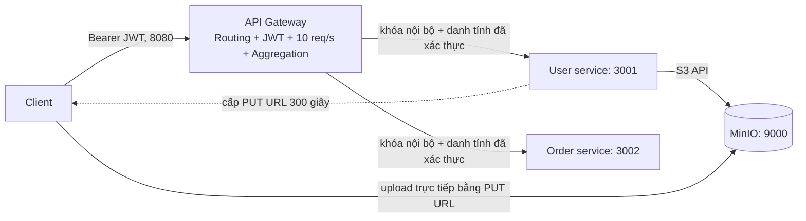

# BTVN bảo mật - Security Design Patterns

Bài làm theo phần **Thực hành: BTVN, trang 19** của tài liệu *Thiết kế cho bảo mật - Design pattern*: hai service User/Order, một API Gateway, JWT, giới hạn 10 request/giây, dashboard tổng hợp và upload ảnh bằng MinIO pre-signed URL 5 phút.

Viết bằng **JavaScript ES Modules trên Node.js 24**. Gateway là ứng dụng Express riêng; đề cho Nginx như một ví dụ, không bắt buộc dùng Nginx. SDK S3 chính thức của AWS được dùng để giao tiếp với MinIO, không cần tài khoản AWS.

## Đối chiếu yêu cầu

| Yêu cầu | Cài đặt | Cách kiểm tra |
|---|---|---|
| Routing | `/users` và `/users/me` -> User; `/orders` -> Order | `npm test`, `npm run test:e2e` |
| JWT tại gateway | RS256, kiểm tra chữ ký, thuật toán, issuer, audience, sub, iat, exp; token sống 15 phút | Token thiếu/sai/hết hạn -> 401 |
| 10 request/giây | Sliding window 1.000 ms theo IP kết nối; request không hợp lệ cũng được tính | 11 request nhanh -> 10 phản hồi hợp lệ + 1 HTTP 429 |
| Aggregation | `/dashboard` gọi User và Order song song, lấy danh tính từ JWT | Trả `user`, `orders`, `partial`, `errors` |
| Valet Key | PUT một object ở MinIO, `X-Amz-Expires=300` | Upload trực tiếp, gọi complete và tải ảnh đã kiểm tra |
| Đo độ trễ | So sánh cùng `/users/me` trực tiếp và qua gateway | `npm run benchmark` -> JSON, CSV, Markdown |

## Kiến trúc



- Chỉ gateway và MinIO được publish lên **loopback** của máy. User/Order ở mạng Docker nội bộ, mặc định không có host port.
- User giữ khóa RSA private để phát token. Gateway chỉ có public key để kiểm tra token.
- Gateway không chuyển tiếp `X-User-Id`, `X-Internal-Key` hoặc `X-Forwarded-For` do client gửi. Gateway tự tạo header nội bộ từ JWT đã xác thực.
- User/Order kiểm tra khóa nội bộ. Mỗi API chỉ trả dữ liệu của user đang đăng nhập; query `?userId=...` không thay đổi danh tính.
- Bucket MinIO riêng tư. URL upload chỉ có quyền PUT vào key ngẫu nhiên của user trong 300 giây. URL này không cấp GET, LIST hoặc quyền ghi key khác.

## Chạy bằng Docker Compose

Cần Node.js 24+ và Docker Desktop đang chạy Linux engine. Chạy các lệnh tại thư mục repo:

```powershell
npm ci
npm run setup
docker compose up -d --build --wait
```

Lần build đầu cần Internet và có thể mất vài phút. MinIO được biên dịch từ mã nguồn chính thức, khóa tại commit `9e49d5e7a648f00e26f2246f4dc28e6b07f8c84a` (release 2025-10-15); không phụ thuộc image `minio/minio` đã không còn tải được. Dockerfile và giấy phép AGPL của MinIO được giữ trong image build. Xem [hướng dẫn build từ nguồn của upstream](https://github.com/minio/minio#install-from-source).

`setup` sinh `.env` và `.secrets/{private,public}.pem`, không ghi đè cấu hình cũ. Mật khẩu demo và MinIO được sinh ngẫu nhiên. Các file bí mật đã nằm trong `.gitignore`.

| Thành phần | Địa chỉ |
|---|---|
| Gateway | http://localhost:8080 |
| Gateway health | http://localhost:8080/health |
| MinIO S3 | http://localhost:9000 |
| MinIO console | http://localhost:9001 |
| User/Order | Không publish ra host mặc định |

Xem log hoặc dừng lab:

```powershell
docker compose logs -f gateway user order
docker compose down
```

`docker compose down` giữ volume MinIO. Không thêm `-v` nếu muốn giữ các object đã upload.

### Chạy các service bằng Node.js trên máy

```powershell
docker compose up -d --build minio --wait
npm run dev
```

Ba tiến trình dùng `127.0.0.1:8080`, `:3001`, `:3002`; cấu hình được đọc từ `.env`. Có thể dùng MinIO cài sẵn bằng cách sửa `MINIO_ENDPOINT` và `MINIO_PUBLIC_ENDPOINT`. Khi chạy client từ máy khác, public endpoint phải là hostname client truy cập được; URL ký sẵn có ràng buộc hostname nên không sửa hostname sau khi ký.

## Gọi API bằng PowerShell

Hai user demo là `alice@example.test` (`user-1`, 2 đơn) và `bob@example.test` (`user-2`, 1 đơn). Cả hai dùng mật khẩu demo được sinh trong `.env`.

```powershell
$demoPassword = (Get-Content .env | Where-Object { $_ -like 'DEMO_PASSWORD=*' }) -replace '^DEMO_PASSWORD=', ''
$body = @{ email = 'alice@example.test'; password = $demoPassword } | ConvertTo-Json
$login = Invoke-RestMethod http://localhost:8080/auth/login -Method Post -ContentType 'application/json' -Body $body
$headers = @{ Authorization = "Bearer $($login.accessToken)" }

Invoke-RestMethod http://localhost:8080/users -Headers $headers
Invoke-RestMethod http://localhost:8080/orders -Headers $headers
Invoke-RestMethod http://localhost:8080/dashboard -Headers $headers | ConvertTo-Json -Depth 8
```

Dashboard bình thường:

```json
{
  "user": { "id": "user-1", "email": "alice@example.test", "name": "Alice", "avatarUrl": null },
  "orders": [
    { "id": "order-101", "userId": "user-1", "product": "Bàn phím", "quantity": 1, "total": 750000, "currency": "VND", "status": "delivered" },
    { "id": "order-102", "userId": "user-1", "product": "Chuột", "quantity": 2, "total": 500000, "currency": "VND", "status": "processing" }
  ],
  "partial": false,
  "errors": []
}
```

### Upload ảnh đại diện theo Valet Key

```powershell
$request = @{ contentType = 'image/png' } | ConvertTo-Json
$upload = Invoke-RestMethod http://localhost:8080/users/me/avatar/upload-url -Method Post -Headers $headers -ContentType 'application/json' -Body $request

# Thay đường dẫn bằng ảnh PNG thật trên máy. File đi thẳng tới MinIO.
Invoke-WebRequest -Uri $upload.uploadUrl -Method Put -InFile .\avatar.png -ContentType 'image/png'

$completeBody = @{ objectKey = $upload.objectKey } | ConvertTo-Json
$profile = Invoke-RestMethod http://localhost:8080/users/me/avatar/complete -Method Post -Headers $headers -ContentType 'application/json' -Body $completeBody
$profile.avatarUrl
```

Chỉ nhận PNG/JPEG. Khi complete, User kiểm tra chủ sở hữu ticket, hạn dùng, dung lượng tối đa 5 MiB và chữ ký đầu file. Dữ liệu đã kiểm tra được ghi sang **key approved mới**, nên dùng lại PUT URL cũ không sửa được avatar đã duyệt. URL đọc avatar cũng có hạn 5 phút; gọi lại `/users/me` để lấy URL đọc mới.

### Endpoint

| Method | Path | Xác thực | Ý nghĩa |
|---|---|---|---|
| GET | `/health` | Không | Liveness, không tính rate limit |
| POST | `/auth/login` | Email + password | Lấy JWT; vẫn chịu rate limit |
| GET | `/users` hoặc `/users/me` | Bearer JWT | Hồ sơ user hiện tại |
| GET | `/orders` | Bearer JWT | Đơn hàng user hiện tại |
| GET | `/dashboard` | Bearer JWT | Gộp hồ sơ và đơn hàng |
| POST | `/users/me/avatar/upload-url` | Bearer JWT | Body `{ "contentType": "image/png" }` |
| POST | `/users/me/avatar/complete` | Bearer JWT | Body `{ "objectKey": "..." }` |

JWT không hợp lệ trả 401; vượt 10 request trong cửa sổ trượt 1 giây trả 429 kèm `Retry-After`. Gateway timeout upstream sau 2 giây. Dashboard trả phần dữ liệu còn dùng được với `partial: true`; cả hai upstream lỗi thì trả 503. Các route riêng lẻ trả 502 khi upstream mất kết nối hoặc 504 khi timeout.

## Kiểm thử và đo độ trễ

```powershell
npm run check
npm test
npm audit --omit=dev

# Cần toàn hệ thống đang chạy:
npm run test:e2e

# Chỉ publish thêm port service cho phép đo trực tiếp, vẫn giới hạn loopback:
docker compose -f compose.yaml -f compose.benchmark.yaml up -d --build --wait
npm run benchmark

# Đo các HTTP app thật trên loopback khi chưa có Docker/MinIO:
npm run benchmark:local
```

- `npm test`: kiểm thử JWT, routing, giả mạo header, cách ly dữ liệu, xử lý timeout/lỗi upstream, aggregation song song, rate limit và ticket upload. Dùng HTTP thật giữa ba app; phần lưu file được thay bằng test double nên không cần Docker.
- `test:e2e`: đăng nhập, routing, dashboard, upload và đọc ảnh thật từ MinIO, từ chối xác nhận ảnh của người khác, từ chối file giả ảnh và kiểm tra 11 request. Kết quả ở `reports/e2e.json`.
- `benchmark`: 50 mẫu cho mỗi đường đi, làm nóng 5 lần, xen kẽ thứ tự gọi, giữ kết nối, nghỉ 140 ms giữa các cặp để vẫn tuân thủ 10 request/giây. Chỉ đo phản hồi HTTP 200 và kiểm tra đúng user.
- `benchmark:local`: tự khởi tạo ba app HTTP thật trên các port loopback tạm thời trong cùng một tiến trình Node; công cụ đo ở tiến trình riêng. Không gọi storage vì hồ sơ seed chưa có avatar. Dùng cùng mã routing/JWT/service và adapter S3 thật, không giả phản hồi. Báo cáo ghi rõ mô hình này; không thay thế kiểm thử upload MinIO hoặc phép đo nhiều container.
- Kết quả đo thật được sinh tại `reports/latency.md`, `.csv`, `.json`, gồm trung bình, p50, p95, min/max và mẫu thô; không có số đo giả định. Có thể tăng số mẫu với `$env:BENCHMARK_SAMPLES=100`.
- Khi không cần đo trực tiếp nữa, chạy `docker compose up -d --force-recreate user order` để quay về cấu hình không publish service.

## Phạm vi lab và giới hạn

- Dữ liệu user, đơn hàng, ticket và con trỏ avatar nằm trong bộ nhớ để tập trung vào design pattern. Khởi động lại service làm mất ticket/con trỏ avatar; object MinIO vẫn ở volume. Chưa có đăng ký, sửa đơn hay cơ sở dữ liệu bền vững.
- Rate limit nằm trong bộ nhớ một gateway instance. Nhiều instance cần bộ đếm tập trung, ví dụ Redis. Cấu hình hiện tại không tin proxy phía trước; nếu triển khai sau proxy cần cấu hình trust proxy theo mạng đáng tin cụ thể.
- Khóa nội bộ dùng để minh họa ranh giới tin cậy, không thay thế mTLS trong môi trường triển khai thật. Lab dùng HTTP trên localhost và mạng Docker nội bộ; chưa triển khai TLS hoặc Sidecar vì không nằm trong yêu cầu BTVN trang 19.
- Pre-signed PUT URL có thể dùng nhiều lần trong 300 giây và không giới hạn dung lượng ngay lúc nhận upload. Giới hạn 5 MiB áp dụng khi xác nhận. Lab kiểm tra magic bytes, chưa giải mã toàn bộ ảnh, quét malware hay dọn object staging tự động. Cần các lớp đó nếu mở cho người dùng thật.
- Tài khoản MinIO trong lab có quyền quản lý bucket để tự khởi tạo; triển khai thực tế cần tách provisioning khỏi tài khoản ứng dụng với policy tối thiểu theo prefix.
- MinIO Community Edition hiện đã được upstream lưu trữ và ngừng bảo trì. Bài tập giữ đúng MinIO theo đề, build từ source release có bản sửa bảo mật tháng 10/2025; chỉ dùng lab cục bộ. Node image đã pin digest, mã nguồn MinIO pin commit; khi dùng môi trường dùng chung cần kiểm tra lại hỗ trợ và an toàn của toàn bộ image nền.

## Cấu trúc

```text
src/gateway/       JWT, sliding-window rate limit, routing, aggregation
src/user/          Login, profile, cấp URL và kiểm tra upload MinIO
src/order/         Đơn hàng theo user
src/shared/        Ranh giới nội bộ, xử lý lỗi, hằng JWT
scripts/           Setup, chạy local, E2E và benchmark
test/              Kiểm thử tự động
docs/              Giải thích design pattern và tình huống demo
infra/minio/       Build MinIO từ source upstream đã pin commit
reports/           Báo cáo sinh từ lần chạy thật (gitignored)
```

Tài liệu tham khảo: [JWT verification của jose](https://github.com/panva/jose), [AWS SDK S3 pre-signed URL](https://docs.aws.amazon.com/sdk-for-javascript/v3/developer-guide/javascript_s3_code_examples.html), [MinIO](https://github.com/minio/minio).
